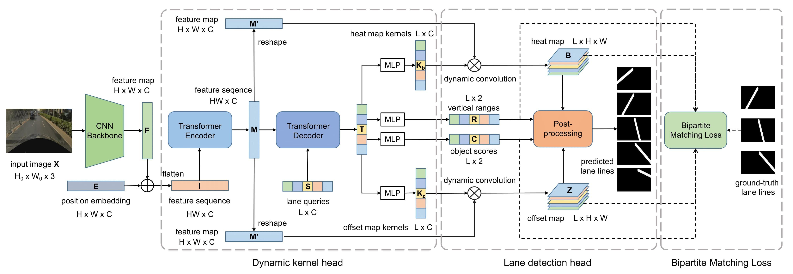

# CondLSTR: 2D and 3D Lane Detection

This repository contains the ICCV 2023 CondLSTR implementation for 2D lane
detection and the 3D journal extension. The 3D model uses lane representations
as the key/value memory for BEV construction and generates the dynamic detection
kernels used in both image and BEV views.

The 3D code is integrated into the same package hierarchy as the original 2D
implementation. The ResNet-34 entry point is
[`modeling/models/models/lane/cond_lstr_3d_res34.py`](modeling/models/models/lane/cond_lstr_3d_res34.py),
the voting head is
[`modeling/models/detectors/lane/cond_lstr_vote_3d`](modeling/models/detectors/lane/cond_lstr_vote_3d),
and both 2D and 3D models use the common training and testing programs in
[`tools/train.py`](tools/train.py) and [`tools/test.py`](tools/test.py).
Dataset adapters and evaluator wrappers for OpenLane, ONCE-3DLanes, and
ApolloSim are under [`data/datasets/lane`](data/datasets/lane) and
[`tools/metrics/lane`](tools/metrics/lane).

The integrated 3D defaults implement the journal protocol: $368\times480$
input, 80 lane queries, a $50\times32$ BEV feature map, and Focal--Dice
heat-map supervision. The trained checkpoints and archival release are being
packaged and will be added before publication.

## Framework
   

## Installation
   1. Create python environment:
      ```
      conda create -n hdmapnet python=3.10
      conda activate hdmapnet
      ```
   2. Install pytorch (>=2.0.0):
      ```
      pip install torch torchvision torchaudio torchdata
      ```
   3. Install mmcv (>=2.0.0):
      ```
      pip install -U openmim
      mim install mmcv
      ```
   4. Install requirements:
      ```
      pip install -r requirements.txt
      ```
   5. Install cuda11.7 (add to your ~/.bashrc and then `source ~/.bashrc`)
      ```
      export CUDA_HOME=/usr/local/cuda-11
      export PATH=$PATH:$CUDA_HOME/bin
      export LD_LIBRARY_PATH=/usr/local/cuda/lib64${LD_LIBRARY_PATH:+:${LD_LIBRARY_PATH}}
      ```

## Prepare Dataset
   1. Put your dataset into `/path/to/datasets/`
   2. Rename the dataset directory with the parameter after `-d`, e.g., `/path/to/datasets/openlane`
   3. A more convenient way is `ln -s /path/to/datasets/original_name /path/to/datasets/openlane`
   4. The directory structure should look like this:
      ```
      /path/to/datasets/
      ├── openlane
      │   ├── images
      │   │   ├── training
      │   │   └── validation
      │   ├── lane3d_1000
      │   │   ├── training
      │   │   ├── validation
      │   │   └── test
      │   │       ├── curve_case
      │   │       ├── merge_split_case
      │   │       └── ...
      │   └── lane3d_3000.tar
      ├── curvelanes
      ├── culane
      └── tusimple
      ```

## Install Evaluation Tools
   1. Install opencv:
      ```
      git clone https://github.com/opencv/opencv.git
      cd ~/opencv
      mkdir build
      cd build
      cmake -D CMAKE_BUILD_TYPE=Release -D CMAKE_INSTALL_PREFIX=/usr/local ..
      make -j7
      sudo make install
      ```
   2. Install openlane evaluation tool:
      ```
      cd /path/to/project/tools/metrics/lane/openlane/lane2d
      # specify your opencv path in ./Makefile#L40,41 (OPENCV_INCLUDE and OPENCV_LIB_PATH)
      make
      ```


## Training & Evaluation

### 3D lane models

The 3D implementation follows the same repository layout as the 2D release and
HDMapNet. Model wrappers are registered from
[`modeling/models/models/lane`](modeling/models/models/lane), the lane-level
`SwapTransformer` and pixel-level `Transformer` live under
[`modeling/models/backbones`](modeling/models/backbones), and the 3D detection
heads and losses live under
[`modeling/models/detectors/lane`](modeling/models/detectors/lane). OpenLane,
ONCE-3DLanes, and ApolloSim datasets, transforms, post-processing, and evaluator
wrappers are kept in their corresponding `data` and `tools` packages.

The registered 3D models use the paper configuration directly: the image
tensor remains $368\times480$ (without padding to a different network input),
the stride-8 image feature is $46\times60$, and the learned BEV feature is
$50\times32$. The image and BEV target rasters are $368\times480$ and
$400\times256$. The models use 80 lane queries; 50 LID depth bins over
$[0,100]$ m; 50 uniform height bins over $[-5,5]$ m; and sigmoid Focal loss
($\alpha=0.25$, $\gamma=2$) plus Dice loss for each heat map. Hungarian
matching and training use object/category/heat-map/offset weights
$(5,1,1,1)$, with a no-object coefficient of 0.4. The target and voting support
scale is 16 raster cells and the inference object threshold is 0.7.

Prepare the OpenLane cache:

```bash
python data/datasets/lane/openlane/preprocess.py \
  --root /path/to/datasets/openlane --version 3d --num-workers 32
```

Train the ResNet-34 3D model through the repository's standard training entry
point:

```bash
python tools/train.py \
  -a CondLSTR3DRes34 -d openlane -v 3d -c 21 -t lane_det_3d \
  --data-dir /path/to/datasets --logs-dir /path/to/checkpoint \
  -b 4 -j 4 -e 50 --lr 1e-4 --milestones 40 --max-grad 35
```

For four-GPU training:

```bash
python -m torch.distributed.launch --nproc_per_node=4 tools/train.py \
  -a CondLSTR3DRes34 -d openlane -v 3d -c 21 -t lane_det_3d \
  --data-dir /path/to/datasets --logs-dir /path/to/checkpoint \
  --gpu-ids 0,1,2,3 -b 4 -j 4 -e 50 --lr 1e-4 \
  --milestones 40 --max-grad 35
```

Evaluation and prediction export use the same standard entry points:

```bash
python tools/train.py \
  -a CondLSTR3DRes34 -d openlane -v 3d -c 21 -t lane_det_3d \
  --data-dir /path/to/datasets --logs-dir /path/to/checkpoint \
  -b 1 -j 4 --resume --eval

python tools/test.py \
  -a CondLSTR3DRes34 -d openlane -v 3d -c 21 -t lane_det_3d \
  --data-dir /path/to/datasets --logs-dir /path/to/checkpoint \
  --test-dir /path/to/output -b 1 -j 4

python tools/metrics/lane/openlane/openlane_3d.py \
  --pred-dir /path/to/output --anno-dir /path/to/datasets/openlane \
  --translate
```

The registered 3D variants include ResNet-18/34/101 and EfficientNet-B7
backbones, the pixel-level transformer control `CondLSTR3DRes34TR`, and the
`CondLSTR3DRes34No2D` and `CondLSTR3DRes34NoSup` ablations.

### Conference 2D model
   1. Training debug:
      ```
      python tools/train.py -a CondLSTR2DRes34 -d openlane -v 2d -c 21 -t lane_det_2d --data-dir /path/to/datasets/  --logs-dir /path/to/checkpoint -b 4 -j 4
      ```
   2. Evaluation debug:
      ```
      python tools/train.py -a CondLSTR2DRes34 -d openlane -v 2d -c 21 -t lane_det_2d --data-dir /path/to/datasets/  --logs-dir /path/to/checkpoint -b 4 -j 4 --eval
      ```
   3. Test/visualization debug:
      ```
      python tools/test.py -a CondLSTR2DRes34 -d openlane -v 2d -c 21 -t lane_det_2d --data-dir /path/to/datasets/  --logs-dir /path/to/checkpoint --test-dir /path/to/output -b 4 -j 4
      ```
   4. Multi-gpu training:
      ```
      python -m torch.distributed.launch --nproc_per_node=4 tools/train.py -a CondLSTR2DRes34 -d openlane -v 2d -c 21 -t lane_det_2d --data-dir /path/to/datasets/  --logs-dir /path/to/checkpoint --gpu-ids 0,1,2,3 -b 4 -j 4
      ```
   5. Multi-gpu evaluation:
      ```
      python -m torch.distributed.launch --nproc_per_node=4 tools/train.py -a CondLSTR2DRes34 -d openlane -v 2d -c 21 -t lane_det_2d --data-dir /path/to/datasets/  --logs-dir /path/to/checkpoint --gpu-ids 0,1,2,3 -b 4 -j 4 --eval
      ```
   6. Multi-gpu test/visualization:
      ```
      python -m torch.distributed.launch --nproc_per_node=4 tools/test.py -a CondLSTR2DRes34 -d openlane -v 2d -c 21 -t lane_det_2d --data-dir /path/to/datasets/  --logs-dir /path/to/checkpoint --test-dir /path/to/output --gpu-ids 0,1,2,3 -b 4 -j 4
      ```
   7. Resume from checkpoint:
      ```
      python -m torch.distributed.launch --nproc_per_node=4 tools/train.py -a CondLSTR2DRes34 -d openlane -v 2d -c 21 -t lane_det_2d --data-dir /path/to/datasets/  --logs-dir /path/to/checkpoint --gpu-ids 0,1,2,3 -b 4 -j 4 --resume
      ```
   8. Training with AMP (Automated Mixed Precision):
      ```
      python -m torch.distributed.launch --nproc_per_node=4 tools/train.py -a CondLSTR2DRes34 -d openlane -v 2d -c 21 -t lane_det_2d --data-dir /path/to/datasets/  --logs-dir /path/to/checkpoint --gpu-ids 0,1,2,3 -b 4 -j 4 -p amp
      ```
   9. Finetune with a pretrained model (Put its `checkpoint.pth.tar` under `/path/to/checkpoint`):
      ```
      python -m torch.distributed.launch --nproc_per_node=4 tools/train.py -a CondLSTR2DRes34 -d openlane -v 2d -c 21 -t lane_det_2d --data-dir /path/to/datasets/  --logs-dir /path/to/checkpoint --gpu-ids 0,1,2,3 -b 4 -j 4 --resume --load-model-only
      ```

## Test
   1. OpenLane
      ```
      python -m torch.distributed.launch --nproc_per_node=4 tools/test.py -a CondLSTR2DRes34 -d openlane -v 2d -c 21 -t lane_det_2d --data-dir /path/to/datasets/  --logs-dir /path/to/checkpoint --test-dir /path/to/checkpoint --gpu-ids 0,1,2,3 -b 4 -j 4
      python tools/metrics/lane/openlane/openlane_2d.py --pred-dir /path/to/output --anno-dir /path/to/datasets/openlane --translate
      ```
   2. CurveLanes


